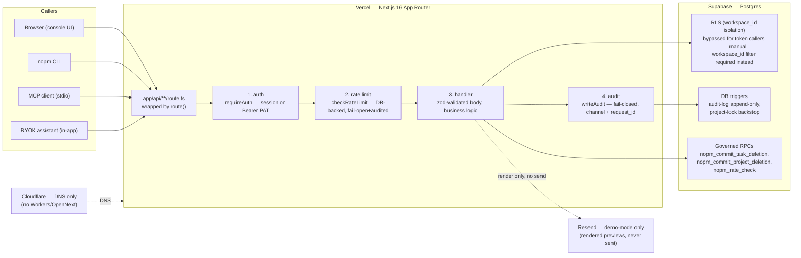
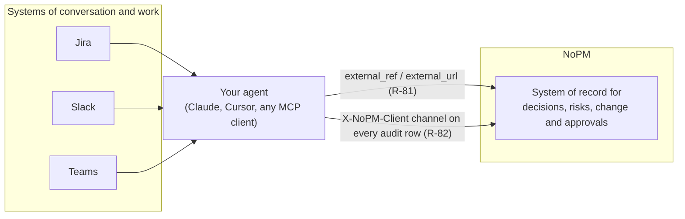
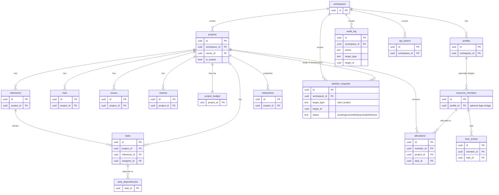

# System Architecture

**Status: ACTIVE**

This is a compiled view, not a new source of truth. Every claim below is traceable to [`README.md`](../../README.md), [`SECURITY.md`](../SECURITY.md), [`CLAUDE.md`](../../CLAUDE.md), `docs/adr/`, or the live codebase — cited inline. Where a fact can drift (counts, versions, migration head), this file points at the file that owns it instead of restating a number that will go stale.

## 1. System on one page

Every write and every read — from a human in the console, the `nopm` CLI, an MCP client, or the in-app BYOK assistant — goes through the same governed path: one Next.js API layer in front of one Postgres database. There is no side door; even token callers (which bypass RLS by using the service-role admin client) are forced through the identical `route()` wrapper and the identical `workspace_id` scoping discipline (`docs/adr/0001-stack-host-scope.md`, "Consequences").

Per-request pipeline (`web/src/lib/api/handler.ts`): **auth → rate-limit → handler → audit**, in that order — rate limiting runs *after* the actor is resolved (so it can key on `workspace_id + actor type`) and *before* the handler runs. `/api/health`, `/api/openapi.json`, `/llms.txt`, and the pre-`route()` auth endpoints are the only surfaces exempt (public/liveness, no workspace-scoped actor to key a limiter on — see that file's own comment).

Host split (`docs/adr/0001-stack-host-scope.md`): **Vercel** hosts the app (first-party Next.js, chosen over Cloudflare Workers/OpenNext specifically to avoid adapter-layer instability risk on a live employer-facing demo). **Cloudflare** is DNS-only. **Resend** stays demo-mode — rendered email previews only, never sent (`CLAUDE.md` "Do NOT build").

## 2. The governance backbone

Governance is enforced in the data + API layer, not the UI (`CLAUDE.md` "Conventions"). Four mechanisms:

### Audit — fail-closed
Every mutation writes exactly one immutable `audit_log` row via `writeAudit`; the trigger backing `audit_log` makes it append-only (`SECURITY.md` "Audit immutability" — a bypass is a high-severity finding). The one documented exception to "exactly one row" is deliberate, not a bug: an allocation write that trips over-allocation also upserts a `clashes` row, which is itself a mutation and gets its own audit row — accepted and explained in `docs/adr/0003-audit-cascade.md` rather than suppressed.

### Four-eyes (maker-checker) — in triplicate, extended to projects
Delete is never a single write. A `deletion_requests` row is **requested**, then a different actor **approves**; the DB `CHECK` constraint plus an API guard both reject self-approval (`SECURITY.md`, `docs/adr/0006-atomic-deletion-and-scope-registry.md`). The commit itself — delete + request-update + **both** audit inserts — runs inside one Postgres function so a mid-crash can never split a committed deletion from its audit trail, and the request row is locked `FOR UPDATE` so two approvers can't race a double-commit (`docs/adr/0006`, migration `20260608000020_atomic_deletion_commit.sql`).

This pattern now **extends to project deletion** (migration `20260814000032_project_deletion_four_eyes.sql`, `web/src/lib/governance/deletion-dispatch.ts`): a dedicated sibling RPC, `nopm_commit_project_deletion`, hardcodes the `projects` table and the `'project.delete'` audit action string — deliberately *not* generalized into one parameterized function, because the audit action string must stay a compile-time-visible literal per entity type (migration 0032's header, "KNOWN TRAP"). The approve route (`web/src/app/api/deletion-requests/[id]/approve/route.ts`) dispatches to the right RPC by the request's `target_type`. Milestones/risks/issues stay audit-only hard-delete by owner decision — maker-checker applies to **projects and tasks only** (`deletion-dispatch.ts` header, citing `requirements/devops-wave1/README.md` Decision 3). **Caveat, verified read-only against `requirements/REQUIREMENTS.md`:** this project-delete extension is live in the codebase and referenced in `testing-log/README.md`'s journey index, but as of this write it has no dedicated R-ID of its own in `REQUIREMENTS.md` — R-03 documents task-delete maker-checker specifically. Treat the code as the current source of truth for this extension until the RTM catches up (owned by a parallel wave, not this doc).

A structurally identical four-eyes pattern also governs change requests (decider ≠ requester, `docs/adr` + `requirements/REQUIREMENTS.md` R-07) and rebaseline sign-off (multi-approver → atomic apply, R-04).

### Lock → rebaseline
A locked project's schedule shape is frozen — enforced three ways at once (schema strip, API guard, DB-trigger backstop with a narrow `nopm.lock_bypass` carve-out for the rebaseline-apply RPC only) so the guarantee holds even if application code has a bug (`requirements/REQUIREMENTS.md` R-65). The project-deletion RPC above deliberately does **not** touch that bypass GUC — it checks `is_locked` once, up front, and fails early with the same `P0010` errcode the lock backstop uses, so the API's existing error-mapping needs no new branch (migration 0032 "ORDERING" note).

### Rate limiting — fail-open, fail-closed, and audited, deliberately different ways
A DB-backed fixed-window counter (`nopm_rate_check` RPC, migration `20260814000029_rate_limiting.sql`) keyed by `workspace_id + actor type + read/write bucket`, defaults 600 reads/min and 120 writes/min (`web/src/lib/api/rate-limit.ts`). Two different failure philosophies apply on purpose: **fail-open + loud** (`console.error`) if the limiter's own RPC errors — a rate-limiter outage must never take the API down; and **fail-closed** (`429 RateLimitError`) on an actual limit hit, with a fail-soft (`try`/`catch`, never blocking the response) `rate.limited` audit row. This is the opposite trade-off from the audit path above — audit failures abort the mutation; rate-limiter failures never do (see memory: fail-closed audit, fail-soft notify — the same discipline applied to a different mechanism).

## 2b. Beside Jira and Slack (complement topology)

NoPM does not compete with Jira, Slack, or Teams for where conversations and day-to-day work happen; those stay the systems of record for chat and ticket flow. The user's own agent, Claude, Cursor, or any MCP client, sits in the middle: it reads threads and tickets in those tools, then writes governed facts into NoPM through the same scoped REST API every other caller uses. NoPM is the system of record for decisions, risks, change, and approvals: every write lands as one immutable audit row, tagged with the caller's channel and, where the source item lives elsewhere, an `external_ref`/`external_url` pointer back to it. This keeps the two worlds cleanly split: conversation and work stay where teams already are, while the governed record of what was decided and who approved it lives in one place (R-81, R-82).

## 3. Data model overview

The 8 PM modules (`requirements/REQUIREMENTS.md` "PM domain") plus the governance tables that make them auditable. This is the core spine and its immediate governance neighbors — not all ~27 tables in `web/supabase/migrations/` (kept under 20 entities per this doc's scope; see the migrations directory for the full schema).

Notes:
- `resource_members.profile_id` is the identity bridge between "who can log in" (`profiles`) and "who does work" (`resource_members`) — task assignment, capacity, and cost all resolve through this one FK, by design (`requirements/REQUIREMENTS.md` R-44; see memory: unify-person-identity for why a wrong FK target here silently severs assignment↔capacity↔cost).
- `deletion_requests.target_type` is the dispatch key for the RPC lookup table described in §2 (`task` → `nopm_commit_task_deletion`, `project` → `nopm_commit_project_deletion`); no other `target_type` is currently wired to a commit RPC.
- Every table above (and every other table in `web/supabase/migrations/`) carries `workspace_id` and RLS (`requirements/REQUIREMENTS.md` R-06, "21 tables" as of that R-ID's last count — re-derive from the migrations directory for a live number, not this doc).

## 4. The three agent surfaces

One governed API, three ways in — plus the in-app assistant, which is not a fourth *surface* so much as a fourth *caller* of the same tool registry (`README.md` "Three agent surfaces, one governed API"):

| Surface | Where | What it gives an agent |
|---|---|---|
| **REST API** | `web/src/app/api/**` — documented at `GET /api/openapi.json` (OpenAPI 3.1) + `GET /llms.txt`, both spec-coverage drift-tested (`requirements/REQUIREMENTS.md` R-21, R-22) | Everything — every mutation audited, scopes enforced per request |
| **`nopm` CLI** | `cli/` — zero dependencies, contract-tested, `--json` machine output, `--curl` dry-run (R-23) | 27 command groups over the same REST API and the same scoped-PAT auth |
| **MCP server** | `web/mcp/` + root `.mcp.json` — stdio, `@modelcontextprotocol/sdk` (`docs/adr/0007-mcp-server.md`, R-25) | Tools mapped 1:1 to the REST API; least-privilege by design — no approve/admin/token tools, so a PAT minted for it can't be escalated through the MCP layer |

The **BYOK in-app assistant** shares the MCP server's tool registry verbatim (`web/mcp/tools.mjs` — one registry, not a copy, per `requirements/REQUIREMENTS.md` R-64) and drives the API through an **ephemeral scoped token**, audited as a token actor, structurally unable to hold an approve/admin scope (`docs/adr/0004-byok-governed-assistant.md`, `CLAUDE.md` "Sanctioned"). The user brings their own OpenAI/Anthropic/Google/OpenRouter key (AES-256-GCM at rest, never returned or logged — `SECURITY.md`); an optional owner-funded demo key exists for the live site only, rate-limited, server-only.

All three surfaces — and the assistant — terminate at the identical `route()` pipeline in §1. Nothing about *how* a request arrived changes what governance applies to it.

## 5. Operational surfaces

| Surface | Endpoint | Notes |
|---|---|---|
| Health | `GET /api/health` | Public liveness probe, `{ auth: false }` — the simplest example of the `route()` contract, deliberately unwrapped by auth/rate-limit (`web/src/app/api/health/route.ts`) |
| OpenAPI | `GET /api/openapi.json` | OpenAPI 3.1, every route documented, drift-tested against the actual route tree (R-21) |
| Agent discovery | `GET /llms.txt` | Endpoint index for agent discovery, its own spec-coverage drift lock (R-22, R-64) |

## Links, not copies

- Cutover / go-live procedure: [`CUTOVER/`](../../CUTOVER/README.md)
- Test evidence for what's currently proven: [`testing-log/`](../../testing-log/README.md)
- What is production right now (the live snapshot table): [`PROD_DOOR.md`](../ops/PROD_DOOR.md)
- Full requirement list + status: [`requirements/REQUIREMENTS.md`](../../requirements/REQUIREMENTS.md)
- Architectural decisions (the whys behind every section above): [`docs/adr/`](../adr/)
